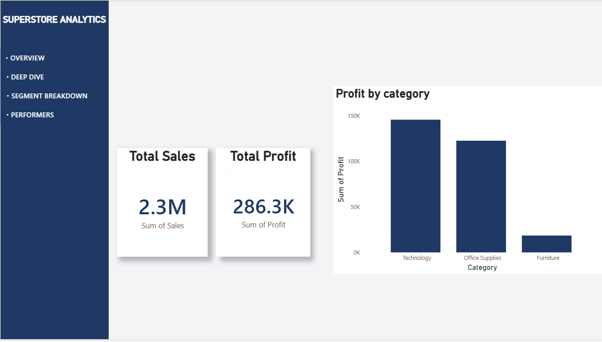
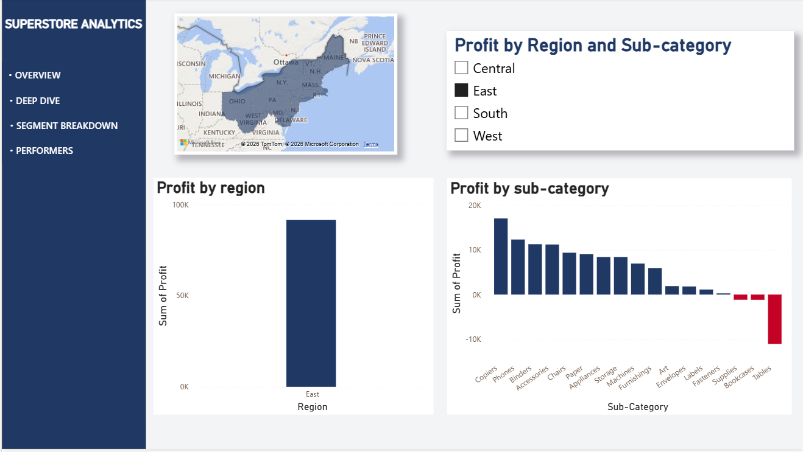
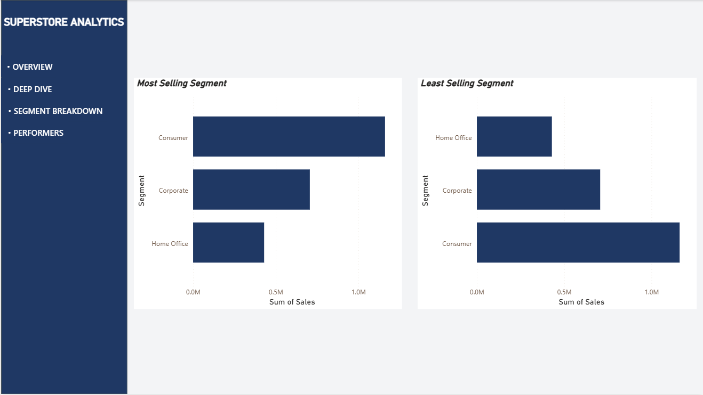
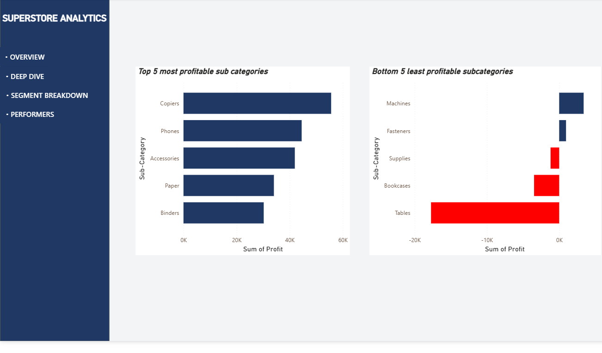

# Superstore Sales Analytics Dashboard

An interactive 4-page Power BI dashboard built on Superstore retail data. SQL (SQLite) was used to clean and explore the data, and Power BI was used to turn the findings into a navigable dashboard.

**Author:** Vishal Kanna | B.Tech Artificial Intelligence & Data Science

**LinkedIn:** https://www.linkedin.com/in/vishal-kanna-r-654069327/

## Business Questions

1. Which product categories and sub-categories actually make money, and which lose it?
2. Which regions and customer segments drive the most sales and profit?
3. Where should the business focus, and what should it fix?

## Tools Used

- **SQL (SQLite via DB Browser for SQLite):** data checks, cleaning, aggregation queries
- **Power BI Desktop:** dashboard design, slicers, conditional formatting, page navigation
- **Dataset:** Sample Superstore (13-column version: Ship Mode, Segment, Country, City, State, Postal Code, Region, Category, Sub-Category, Sales, Quantity, Discount, Profit)

## Dashboard Pages

| Page | What it shows |
|---|---|
| Total Sales & Profit | KPI cards (Total Sales 2.3M, Total Profit 286.3K) and profit by Category |
| Deep Dive (Region) | Profit by Region and Sub-Category with a Region slicer, plus a profit map by State |
| Segment Breakdown | Most and least selling customer segments by sales |
| Top and Bottom Performers | Top 5 and bottom 5 sub-categories by profit, losses highlighted in red |

### Overview

### Deep Dive

### Segment Breakdown

### Top and Bottom Performers

## Key Insights

- **Technology and Office Supplies drive almost all profit** (about 147K and 122K), while **Furniture lags far behind** (about 20K).
- **West is the most profitable region (about 108K)**; Central is the weakest (about 40K).
- **Copiers, Phones and Accessories are the top profit-generating sub-categories.**
- **Tables is the worst performer: it loses about 18K**, by far the biggest loss of any sub-category. Bookcases and Supplies also run at a loss.
- **Consumer is the leading segment** in both sales and profit, followed by Corporate, with Home Office last.

## SQL Techniques Used

- Aggregations: `SUM`, `COUNT`, `AVG`, `MIN`, `MAX`
- `GROUP BY` with `HAVING` for filtering on aggregates
- `ORDER BY` with `LIMIT` for top/bottom rankings
- Calculated columns (e.g. `Sales - Profit`)
- Data quality checks: duplicates, NULL values, out-of-range values

## Data Cleaning Notes

- Header row was imported as a data row on first load; the table was dropped and re-imported with "column names in first line" enabled.
- Checked for duplicate rows, NULLs in key columns, and impossible values (negative sales, discounts outside 0-1). Negative profit was kept, since it reflects real loss-making orders.

## Limitations

This version of the dataset has no order date, customer name or product name, so **time-based trends and product-level analysis are not included**. A natural next step is to rebuild this using the full Superstore dataset to add year-over-year trends.

## Repository Contents

- `Superstore_Analytics.pbix`: the Power BI dashboard
- `queries.sql`: SQL queries used for the analysis
- `screenshots/`: dashboard page images
